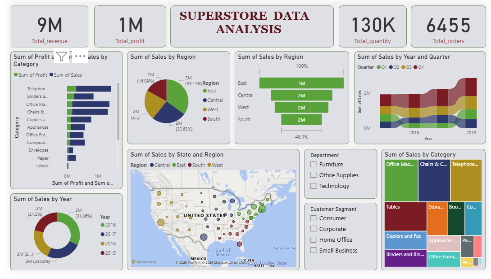
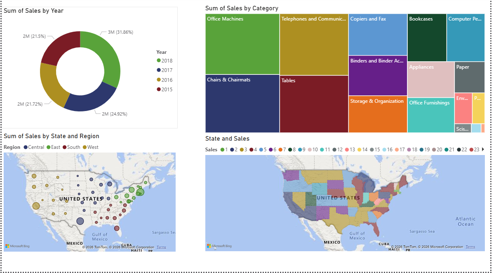
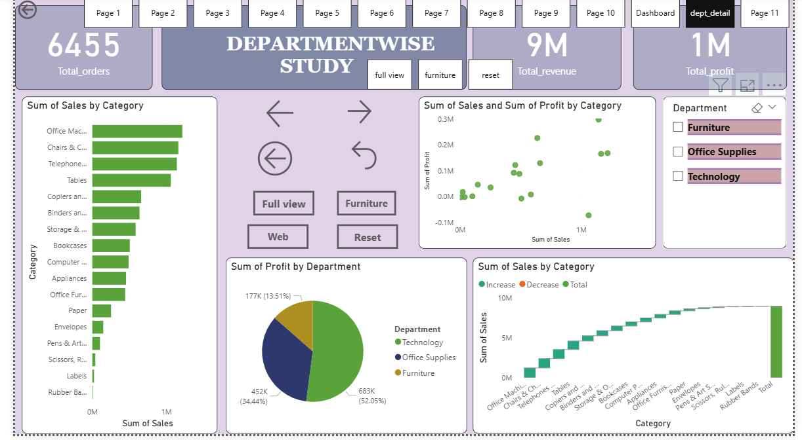
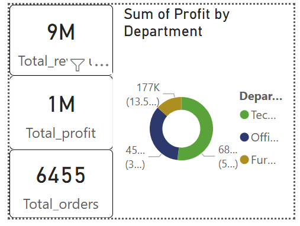

## Superstore-sales-dashboard
Interactive Power BI dashboard Analysing Superstore sales, profit and trends.

## About
An interactive Power BI dashboard that analyses Superstore sales,
profit and trends across regions, categories and time.

## Tools Used
Power BI (add Excel, Power Query, DAX or SQL only if you used them)

## Process
Cleaned and modelled the Superstore sales data and built an
interactive dashboard with [slicers, KPI cards, charts].

## Key Insights
- Insight 1 (for example, which region had the highest sales)
- Insight 2 (for example, which category had the lowest profit)

## Dashboard Preview
### 1. Overall Dashboard

### 2. Map Analysis

### 3. Department Details

### 4. Tooltips

